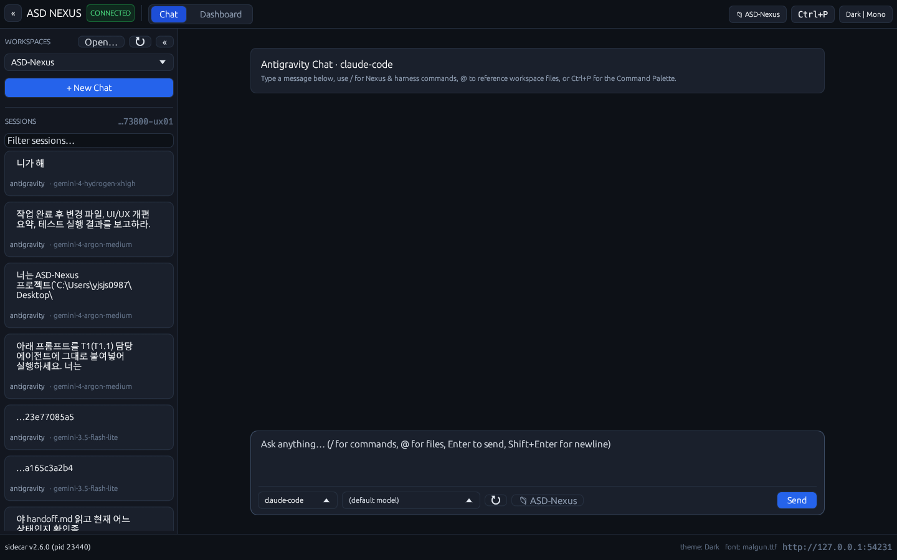
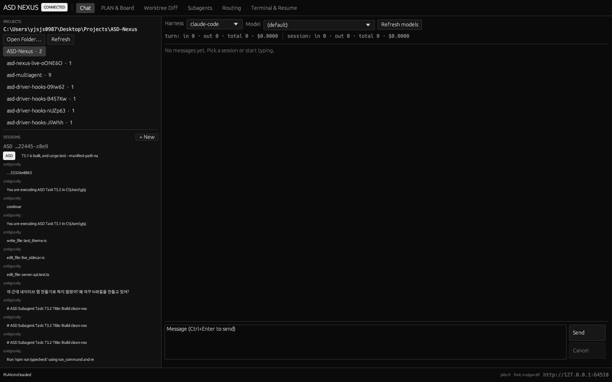

# ASD-Nexus

[English](README.md) | 한국어

`agent-swarm-director`(ASD) 멀티 에이전트 런타임을 위한 네이티브 컨트롤 플레인입니다. WebView 없이 Node HTTP/SSE 사이드카와 Rust 워크스페이스(데스크톱 GUI, TUI, 스크립트 CLI)로 구성됩니다.

`claude-code`, `codex`, `opencode`, `antigravity`, `cursor` 5개 하네스를 한 곳에서 제어합니다.

| 다크 컬러 (기본) | 모노크롬 |
|---|---|
|  |  |

## 주요 기능

- **네이티브 데스크톱 GUI** (`asd-nexus-desktop`): `eframe`/`egui` 창, `Chat` | `Dashboard` 분할(`Ctrl+1` / `Ctrl+2`), WebView 0%.
- **TUI 및 CLI** (`asd-nexus-cli`): OpenCode 스타일의 테두리 없는 TUI와 `health`, `sessions`, `board` 서브커맨드(`--json` 지원).
- **통합 채팅**: 5개 하네스의 트랜스크립트를 동일한 형식으로 정규화해 사고 블록, 도구 호출, 마크다운 응답을 표시합니다.
- **세션 제어**: 세션 탐색, ASD 세션 승격, 강등, 연결 해제, 메모, 포그라운드 지정, 단계(phase) 변경.
- **계획 및 오케스트레이션**: 드리프트 감지가 있는 `PLAN.md` 편집, 진행 보드, 디스패치, 토론(debate), 태스크 승인/거절.
- **워크스페이스 도구**: 워크트리 diff, 라우팅 설정 편집, 서브에이전트 모니터와 로그, 재개(resume) 명령 생성.
- **작성 UX**: `/` 슬래시 명령 팔레트(내장 + 전역/프로젝트 `.md` 명령), `@` 파일 자동완성, `!` 로컬 셸 실행, `Ctrl+P` 명령 팔레트.
- **두 가지 테마**: 기본 다크 컬러와 엄격한 그레이스케일 모노크롬(`R == G == B`) 토글.
- **모델 카탈로그**: 부분 갱신을 병합하는 하네스 모델 탐색.

## 아키텍처

```
Rust 데스크톱 / TUI / CLI  <-- HTTP + SSE -->  Node 사이드카 (src/server)
                                                    |
                                                    v
                                     agent-swarm-director SDK (>= 2.6.0)
                                                    |
                                                    v
                     claude-code / codex / opencode / antigravity / cursor
```

- ASD SDK와 통신하는 프로세스는 사이드카 하나뿐입니다. Rust 클라이언트는 코어 로직(DB 접근, 명령 조립, 트랜스크립트 파싱, 라우팅)을 재구현하지 않습니다.
- 클라이언트는 `--port 0`으로 사이드카를 실행하고 stdout의 JSON 준비 핸드셰이크 한 줄을 읽은 뒤, stdin EOF로 종료합니다.
- 하네스 CLI 명령 조립은 SDK의 `buildSpawnSpec` 계열만 사용합니다. `src/`에는 `child_process` import가 없습니다.
- 런타임 버전 게이트는 `agent-swarm-director >= 2.6.0`을 허용하며, 더 오래된 런타임은 시작 시 명확한 오류로 거부합니다.

## 요구 사항

- Node.js `>= 22.13.0`
- `agent-swarm-director` `>= 2.6.0` — 이 저장소 기준 `../../code/asd-runtime` 경로의 로컬 `file:` 의존성입니다. 설치 전에 해당 체크아웃을 준비하거나 `package.json`의 경로를 수정하세요.
- Rust stable 툴체인 (edition 2021)
- 실제 대화 턴을 실행하려면 해당 하네스 CLI가 `PATH`에 있고 인증되어 있어야 합니다.

## 빠른 시작

```bash
npm install
```

Rust 워크스페이스 빌드:

```bash
cargo build --release --manifest-path native/Cargo.toml --locked
```

클라이언트가 `src/server/index.ts`를 찾을 수 있도록 저장소 루트에서 GUI 또는 TUI를 실행합니다.

```powershell
.\native\target\release\asd-nexus-desktop.exe
.\native\target\release\asd-nexus-cli.exe
```

```bash
./native/target/release/asd-nexus-desktop
./native/target/release/asd-nexus-cli
```

스크립트 CLI:

```bash
./native/target/release/asd-nexus-cli health --json --project-root .
./native/target/release/asd-nexus-cli sessions --json --limit 5
./native/target/release/asd-nexus-cli board --json
```

사이드카 직접 실행(일반적으로는 클라이언트가 자동 실행):

```bash
npm start                       # node src/server/index.ts, JSON 준비 줄 1회 출력
```

클라이언트 주요 플래그: `--project-root <dir>`, `--server-url <url>`(실행 중인 사이드카에 연결), `--token <tok>`, `--harness <id>`, `--model <name>`, `--session <asd-id>`, `--json`. 데스크톱 앱은 추가로 `--theme dark|mono`, `--verify`, `--screenshot <file.bmp>`, `--exit-after <secs>`, `--node <path>`, `--server-script <path>`를 지원합니다.

## API 표면

모든 라우트는 `127.0.0.1`에서 제공됩니다. 토큰이 설정된 경우 `Authorization: Bearer <token>` 헤더가 필요합니다.

| 영역 | 엔드포인트 |
|---|---|
| 상태 및 프로젝트 | `GET /api/health`, `GET /api/projects`, `POST /api/projects/select`, `GET/POST /api/projects/resolve` |
| 모델 및 라우팅 | `GET /api/models`, `POST /api/models/refresh`, `GET/POST /api/routing` |
| 세션 | `GET/POST /api/sessions`, `POST /api/sessions/{promote,demote,unlink,delete,memo,foreground,phase}` |
| 턴 | `POST /api/turn/stream` (SSE), `POST /api/turn/cancel` |
| 계획 | `GET/POST /api/plan`, `POST /api/plan/sync`, `POST /api/dispatch`, `POST /api/debate` |
| 보드 및 태스크 | `GET /api/board`, `GET /api/worktree/diff`, `POST /api/tasks/{approve,reject}` |
| 서브에이전트 | `GET /api/subagents`, `GET /api/subagents/logs`, `POST /api/subagent-action` |
| 워크스페이스 | `GET /api/harness-commands`, `GET /api/fs/list`, `POST /api/terminal/open` |

## 테스트

```bash
npm run typecheck
node --no-warnings --test tests/server-api.test.ts tests/model-catalog.test.ts tests/normalizer-replay.test.ts tests/sdk-surface.test.ts
cargo test --manifest-path native/Cargo.toml --workspace --locked
```

오프라인 Node 스위트는 픽스처 리플레이, 청크 경계 동등성, SDK 표면 규칙, 모델 카탈로그 병합, HTTP/SSE 라우트, 실제 `--port 0` 사이드카 수명주기를 포함한 76개 테스트를 실행합니다.

라이브 5-하네스 E2E 스위트(`node --no-warnings --test tests/live-5harness-e2e.test.ts`)는 임시 git 저장소에서 5개 CLI로 실제 턴을 실행합니다. 수 분이 걸릴 수 있고, `docs/evidence/e2e-5harness-summary.json`을 갱신하며, 모든 하네스가 설치·인증되어 있어야 합니다.

## 프로젝트 구조

```
src/server/          Node 사이드카: 라우트, 노멀라이저, 모델 카탈로그, SDK 경계
src/shared/          공유 프로토콜 타입 (HTTP/SSE DTO)
tests/               Node 테스트 스위트 (오프라인 + 라이브 E2E)
native/              Rust 워크스페이스
  asd-nexus-client/    HTTP/SSE 클라이언트와 사이드카 수명주기
  asd-nexus-cli/       TUI 및 스크립트 CLI
  asd-nexus-desktop/   네이티브 데스크톱 GUI
docs/                테스트 가이드, 검증 리포트, 증거 캡처
asd-tui-gui-docs/    ASD SDK 참조 문서 (vendored)
```

## 문서

- [테스트 가이드 (한국어)](docs/testing-guide-ko.md)
- [Testing guide (English)](docs/testing-guide.md)
- [검증 리포트](docs/verification-report.md)
- [라이브 E2E 증거](docs/evidence/e2e-5harness-summary.json)

## 라이선스

ASD-Nexus는 [MIT 라이선스](LICENSE)로 배포됩니다.

`agent-swarm-director` 런타임은 별도 의존성이며 Functional Source License 1.1 + Apache 2.0 전환 조항(`FSL-1.1-ALv2`)으로 배포됩니다. 해당 조건은 이 저장소의 MIT 라이선스에 포함되지 않으므로, 번들 제품을 재배포하기 전에 런타임 라이선스를 확인하세요.
