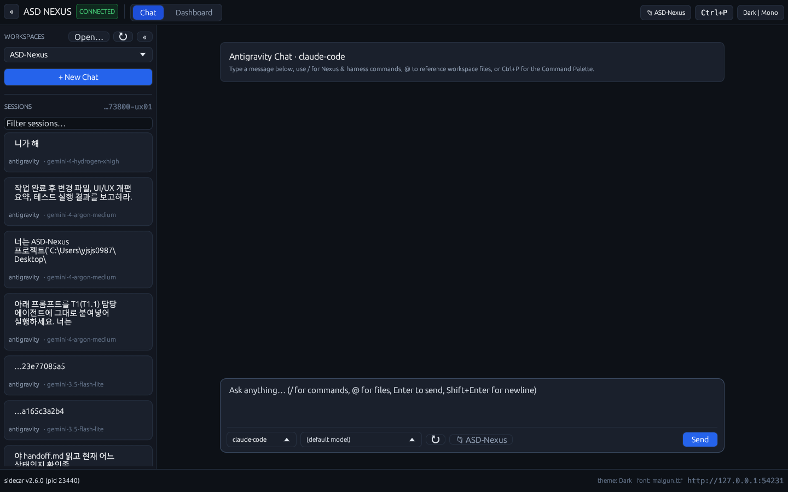
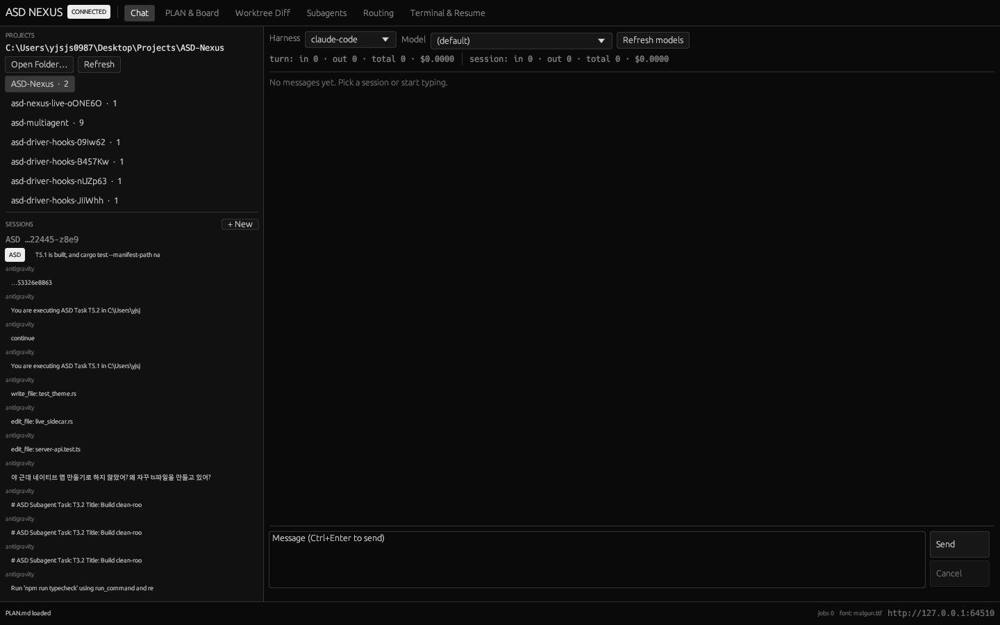

# ASD-Nexus

English | [한국어](README.ko.md)

A native, WebView-free control plane for the `agent-swarm-director` (ASD) multi-agent runtime. ASD-Nexus pairs a Node HTTP/SSE sidecar with a Rust workspace that ships a desktop GUI, a TUI, and a scriptable CLI.

It drives five harnesses from one place: `claude-code`, `codex`, `opencode`, `antigravity`, and `cursor`.

| Dark Color (default) | Monochrome |
|---|---|
|  |  |

## Features

- **Native desktop GUI** (`asd-nexus-desktop`): `eframe`/`egui` window with a `Chat` | `Dashboard` split (`Ctrl+1` / `Ctrl+2`), 0% WebView.
- **TUI and CLI** (`asd-nexus-cli`): OpenCode-inspired borderless TUI plus `health`, `sessions`, and `board` subcommands with `--json` output.
- **Unified chat**: normalized transcripts across all five harnesses, including thinking blocks, tool calls, and markdown responses.
- **Session control**: discovery, promotion to ASD sessions, demotion, unlinking, memos, foreground selection, and phases.
- **Planning and orchestration**: `PLAN.md` editing with drift detection, progress board, dispatch, debate, and task approve/reject.
- **Workspace tooling**: worktree diff, routing config editor, subagent monitor with logs, and resume-command generation.
- **Composer UX**: `/` slash-command palette (built-in plus global/project `.md` commands), `@` file autocomplete, `!` local shell execution, and `Ctrl+P` command palette.
- **Two themes**: Dark Color by default with a strict grayscale Monochrome toggle (`R == G == B`).
- **Model catalog**: discovered harness models merged across partial refreshes.

## Architecture

```
Rust desktop / TUI / CLI  <-- HTTP + SSE -->  Node sidecar (src/server)
                                                    |
                                                    v
                                     agent-swarm-director SDK (>= 2.6.0)
                                                    |
                                                    v
                     claude-code / codex / opencode / antigravity / cursor
```

- The sidecar is the only process that talks to the ASD SDK. Rust clients never reimplement core logic (database access, command assembly, transcript parsing, routing).
- Clients spawn the sidecar with `--port 0`, read the single-line JSON readiness handshake from stdout, and shut it down with stdin EOF.
- Harness CLI command assembly goes exclusively through the SDK's `buildSpawnSpec` family. `src/` contains zero `child_process` imports.
- The runtime version gate accepts any `agent-swarm-director >= 2.6.0`; older runtimes are rejected at startup with an actionable error.

## Requirements

- Node.js `>= 22.13.0`
- `agent-swarm-director` `>= 2.6.0`, wired as a local `file:` dependency (`../../code/asd-runtime` relative to this repository). Check out that repository, or repoint the dependency in `package.json`, before installing.
- Rust stable toolchain (edition 2021)
- For live chat turns: the corresponding harness CLIs on `PATH`, authenticated

## Quick Start

```bash
npm install
```

Build the Rust workspace:

```bash
cargo build --release --manifest-path native/Cargo.toml --locked
```

Run the desktop GUI or the TUI from the repository root so the client can locate `src/server/index.ts`:

```powershell
.\native\target\release\asd-nexus-desktop.exe
.\native\target\release\asd-nexus-cli.exe
```

```bash
./native/target/release/asd-nexus-desktop
./native/target/release/asd-nexus-cli
```

Scriptable CLI:

```bash
./native/target/release/asd-nexus-cli health --json --project-root .
./native/target/release/asd-nexus-cli sessions --json --limit 5
./native/target/release/asd-nexus-cli board --json
```

Run the sidecar directly (clients normally do this for you):

```bash
npm start                       # node src/server/index.ts, prints one JSON ready line
```

Useful client flags: `--project-root <dir>`, `--server-url <url>` (attach to a running sidecar), `--token <tok>`, `--harness <id>`, `--model <name>`, `--session <asd-id>`, `--json`. The desktop app additionally supports `--theme dark|mono`, `--verify`, `--screenshot <file.bmp>`, `--exit-after <secs>`, `--node <path>`, and `--server-script <path>`.

## API Surface

All routes are served from `127.0.0.1`; when a token is configured, requests need `Authorization: Bearer <token>`.

| Area | Endpoints |
|---|---|
| Health & projects | `GET /api/health`, `GET /api/projects`, `POST /api/projects/select`, `GET/POST /api/projects/resolve` |
| Models & routing | `GET /api/models`, `POST /api/models/refresh`, `GET/POST /api/routing` |
| Sessions | `GET/POST /api/sessions`, `POST /api/sessions/{promote,demote,unlink,delete,memo,foreground,phase}` |
| Turns | `POST /api/turn/stream` (SSE), `POST /api/turn/cancel` |
| Planning | `GET/POST /api/plan`, `POST /api/plan/sync`, `POST /api/dispatch`, `POST /api/debate` |
| Board & tasks | `GET /api/board`, `GET /api/worktree/diff`, `POST /api/tasks/{approve,reject}` |
| Subagents | `GET /api/subagents`, `GET /api/subagents/logs`, `POST /api/subagent-action` |
| Workspace | `GET /api/harness-commands`, `GET /api/fs/list`, `POST /api/terminal/open` |

## Testing

```bash
npm run typecheck
node --no-warnings --test tests/server-api.test.ts tests/model-catalog.test.ts tests/normalizer-replay.test.ts tests/sdk-surface.test.ts
cargo test --manifest-path native/Cargo.toml --workspace --locked
```

The offline Node suite covers 76 tests across fixture replay, chunk-boundary equivalence, SDK surface rules, model catalog merging, HTTP/SSE routes, and real `--port 0` sidecar lifecycle.

The live five-harness E2E suite (`node --no-warnings --test tests/live-5harness-e2e.test.ts`) runs real turns through all five CLIs in temporary git repositories. It can take several minutes, writes `docs/evidence/e2e-5harness-summary.json`, and requires every harness to be installed and authenticated.

## Project Layout

```
src/server/          Node sidecar: routes, normalizer, model catalog, SDK boundary
src/shared/          Shared protocol types (HTTP/SSE DTOs)
tests/               Node test suites (offline + live E2E)
native/              Rust workspace
  asd-nexus-client/    HTTP/SSE client and sidecar lifecycle
  asd-nexus-cli/       TUI and scriptable CLI
  asd-nexus-desktop/   Native desktop GUI
docs/                Testing guides, verification report, evidence captures
asd-tui-gui-docs/    Vendored ASD SDK reference documents
```

## Documentation

- [Testing guide (English)](docs/testing-guide.md)
- [Testing guide (Korean)](docs/testing-guide-ko.md)
- [Verification report](docs/verification-report.md)
- [Live E2E evidence](docs/evidence/e2e-5harness-summary.json)

## License

ASD-Nexus is released under the [MIT License](LICENSE).

The `agent-swarm-director` runtime is a separate dependency distributed under the Functional Source License 1.1 with an Apache 2.0 future license (`FSL-1.1-ALv2`). Its terms are not covered by this repository's MIT license; review them before redistributing a bundled product.
